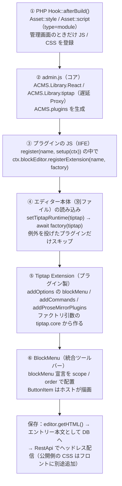

# BlockEditorImageFloat 設計書 — 画像のテキスト回り込み（フロート）

a-blog cms のブロックエディターに機能を追加する**独立したプラグイン**の設計書。この 1 冊だけで実装を始められるようにしてある。

関連：[絵文字（BlockEditorEmoji） の設計書](https://github.com/uidev1116/acms-block-editor-emoji/blob/master/docs/design.md)（別プラグイン。依存関係はなく、並行して実装できる）

作成 2026-10-18 ／ 対象 @ablogcms/* 3.2.37（Tiptap 3.3x / React 19） ／ ビルド Vite 8 ライブラリモード（IIFE） ／ plugins/BlockEditorImageFloat/

> **UI パターン：A1（独立トグル 2 つ）に決定**
>
> 4 パターン（A1〜A4）の比較のうち A1 を採用した（UI モックと付録の要約は手元用でコミットしない）。保存形式（4.2）はどの案でも同じ。

## 1. 概要とゴール

#### BlockEditorImageFloat（画像フロート）

画像ブロックに CKEditor 5 の「Wrap text: Left / Right aligned image」と同じ**回り込み配置**を追加する。既存の「左・中央・右寄せ」（回り込まずに段落を分ける配置）とは**別のボタン**にする。

> **原則**
>
> - a-blog cms コア（`ablogcms/js`、`php` など）は**編集しない**（CLAUDE.md）。拡張はすべて公開されている拡張基盤 `ACMS.plugins` 経由で行う。
> - Tiptap / ProseMirror / React は**ホスト（コア）と同じインスタンスを使う**。プラグインに同梱すると ProseMirror が二重化して `instanceof` 判定やスキーマ互換が壊れるため（`@ablogcms/block-editor/tiptap` の型コメントに明記されている）。
> - 保存される HTML は、**プラグインを無効化しても壊れず、ヘッドレス（RestApi）で配信されるフロント側でもそのまま扱える**形にする。

## 2. @ablogcms パッケージ調査

npm の `@ablogcms` スコープには 3.2.37 時点で 23 パッケージがある。`npm pack` で中身（`.d.ts` と `dist`）を取得し、ローカルのコア（`ablogcms/js/src/admin.js`、`features/block-editor/*`）と照らし合わせて確認した。

### 2.1 パッケージ一覧と採否

【実行時に使う】 バンドルに入る（どれも数 KB の薄いファサード） 【型だけ】 `import type` 専用の devDependency。実体はホストのものを使う 【使わない】

| パッケージ | 中身 | 採否 | 用途・理由 |
|---|---|---|---|
| `@ablogcms/plugins` | `ACMS.plugins` へのファサード。`register(name, {setup(ctx)})` | 【実行時】 | 入口。`ctx.blockEditor.registerExtension` / `ctx.i18n` / `ctx.config` / `ctx.keyboardShortcuts` を使う。`unregister` 時は自動で後片付けされる。 |
| `@ablogcms/block-editor` | Tiptap ベースのブロックエディター本体 | 【型だけ】 | `/types`（`BlockMenuToolbarItem`、`BlockDefinition`）、`/tiptap`（`Tiptap` 型 ＝ ファクトリに渡されるランタイム）。**値は import しない**（本体が丸ごと同梱される）。 |
| `@ablogcms/i18n` | `t()` のファサード（`ACMS.i18n` に委譲） | 【実行時】 | ツールチップなどの翻訳を引く。登録は `ctx.i18n.addResources`、参照は `t('plugin-name:key')`。 |
| `@ablogcms/events` | 型付きイベントバス（`ACMS.events`） | 【使わない】 | この機能はエディター内で完結し、フックすべきイベントが無い（ブロックエディター系のイベントは未定義）。購読が必要になったら `ctx.events.on` を使う（直接 import は不要）。 |
| `@ablogcms/types` | 横断型。`MaterialSymbol` 等 | 【型だけ】 | アイコン名の型チェック。`format_image_left` / `format_image_right` が存在することを確認済み。 |
| `@ablogcms/components` | 管理画面 UI 部品（popover, dropdown-menu など） | 【使わない】 | `react-dom`・`@floating-ui/react`・`@dnd-kit` などに依存し、`ReactDOM` はグローバルに公開されていないため、同梱すると重いうえに二重化する。ツールバーのボタンはホストの描画（`BlockMenuButtonItem`）に任せる。 |
| `@ablogcms/react-utils` / `react-hooks` | React ヘルパー | 【使わない】 | このプラグインは React を使わない。 |
| `@ablogcms/dialog` / `notify` / `media` ほか | — | 【使わない】 | 不要。 |

### 2.2 拡張の仕組み（読み込みから描画まで）



登録は `setup()` 内で同期的に完了し、Tiptap の値を必要とする処理はファクトリ（④の時点）まで遅らせる。これがこの拡張基盤の要点。

### 2.3 使う拡張ポイント（実際の型定義から抜粋）

| API | 型 / 挙動 | 使い方 |
|---|---|---|
| `ctx.blockEditor.registerExtension(name, factory)` | `(tiptap: Tiptap) => AnyExtension \| AnyExtension[] \| Promise<…>` | 1 つの `Extension` を返す。新しいノードは作らない（4.2）。 |
| `Tiptap`（ファクトリ引数） | `{ core, react, suggestion, pm: { state, model, view, transform, commands, keymap, inputrules, … } }` | `core.Extension.create` だけを使う。 |
| 拡張の `addOptions().blockMenu` | `BlockMenuButtonItem`: `{ scope, order, icon, tooltip, ariaLabel?, isActive?, isDisabled?, onSelect }`<br>`BlockMenuRenderItem`: `{ scope, order, render({editor, variant}) }` | ツールバーへのボタン追加。`scope: 'image'` は画像ブロック選択時、`'text'` はテキストブロック時に表示。コアの画像セクションは `order: -100`（`CORE_BLOCK_MENU_SECTION_ORDER`）なので、それより大きい値ならコアの後ろに並ぶ。 |
| `ctx.i18n.addResources(lng, resources)` | 名前空間はプラグイン名で固定 | `t('block-editor-image-float:wrap.left')` のように参照。 |
| `ctx.config` | `ACMS.Config[camelCase(プラグイン名)]` | PHP から渡す設定値。現在は使っていない（既定幅の自動変更をやめたため）。 |
| `ctx.blockEditor.registerBlockDefinition` | スラッシュメニューや「ブロック追加」の項目 | **使わない**（回り込みはブロックの挿入ではないため）。 |

### 2.4 参考にした公式ドキュメント

| ドキュメント | この設計での使い方 |
|---|---|
| [プラグイン（拡張アプリ）開発の基本](https://developer.a-blogcms.jp/document/develop_apps/entry-2906.html) / [名前空間](https://developer.a-blogcms.jp/document/develop_apps/entry-2907.html) | `ServiceProvider.php` の書き方。名前空間は `Acms\Plugins\{Name}`（3.5）。 |
| [フックの拡張](https://developer.a-blogcms.jp/document/develop_apps/entry-2910.html) | `Hook::afterBuild()` で管理画面のときだけアセットを登録する（3.5）。 |
| [acms-plugin-skeleton](https://github.com/appleple/acms-plugin-skeleton) | リポジトリのひな型（3.3・3.6）。 |
| [アセット API](https://developer.a-blogcms.jp/document/develop_apps/asset-api.html) | JS / CSS の読み込み（3.5）。`type="module"` の指定、ハンドル名、自動バージョン付与。 |
| [テンプレートの挿入](https://developer.a-blogcms.jp/document/develop_apps/entry-2912.html) | 使わない（HTML を差し込む仕組みのため）。 |
| [プラグインのテスト](https://developer.a-blogcms.jp/document/develop_apps/plugin-testing.html) / [CI と複数バージョン検証](https://developer.a-blogcms.jp/document/develop_apps/plugin-testing-ci.html) | スケルトンに PHPUnit（`ablogcms/testing-framework` `3.2.*`）・PHPStan・phpcs と CI が設定済みなので、そのまま使う。PHP のロジックは `Services/AssetRegistrar` に切り出して単体テストする（3.5）。JS は vitest。 |
| 管理画面の JavaScript 拡張（`document/javascript/admin-js/`） | 2026-10-18 時点では目次だけで本文が未公開。`ACMS.plugins` の仕様は npm パッケージの型定義とコアのソースから確認した（2.1〜2.3）。 |

## 3. ビルド・配置・読み込み

### 3.1 ビルドツール：Vite 8 ライブラリモード、出力形式は IIFE

| 候補 | 判断 | 理由 |
|---|---|---|
| **Vite（lib mode, `formats: ['iife']`）** | 【採用】 | テーマ（`ablogcms/themes/develop`）ですでに Vite を使っている。`external` と `output.globals` の組み合わせで「`react` → `ACMS.Library.React`」のような externals を素直に書ける。React（JSX）・TypeScript・CSS がそのまま使える（CSS は Sass を使わず素の CSS で書く）。 |
| Vite（`formats: ['es']`）＋ `rollup-plugin-external-globals` | 【不採用（代替案）】 | ES 出力では external が `import React from 'react'` のまま残るため、`rollup-plugin-external-globals` で `ACMS.Library.*` の参照に書き換える（Vite 8.3.4 で動作確認済み）。`await import()` の部分が別ファイルになり、エディターを開くまでダウンロードもされないのが利点。ただしプラグインが 1 つ増え（2024-11 以降更新なし）、このプラグインの規模では IIFE で十分なので採用しない。JS が大きくなったら切り替えを検討する。 |
| webpack | 【不採用】 | コアは webpack だが、externals の書き方が違うだけで得るものが無い。テーマと揃える方を優先。 |
| tsup / esbuild 単体 | 【不採用】 | IIFE の globals 対応や CSS の書き出しで設定が増える。 |

#### Tiptap を使うコードを書く場所（読み込み順の制約）

プラグインの JS とエディター本体は、次の順番で読み込まれる。

| 時点 | 起きること | Tiptap（`ACMS.Library.tiptap`） |
|---|---|---|
| ① 管理画面を開く | コアの `admin.js` とプラグインの JS が読み込まれ、プラグインの `register()` → `setup()` が走る | **まだ無い**（中身が空の入れ物だけある。触ると例外） |
| ② エディターを表示する | コアがブロックエディター本体（別ファイル）を読み込む | ここで中身が入る |
| ③ その直後 | コアが、プラグインから預かったファクトリ `(tiptap) => …` を呼び、**Promise なら解決を待つ**（`block-definitions.ts`） | 使える |

したがって Tiptap の値（`Extension.create` など）は**ファクトリの中（③）で使う**。公式・サードパーティの Tiptap 拡張パッケージ（`@tiptap/extension-*`）は、ファイルの一番外側で `Node.create()` を実行するので、**ファクトリの中で `await import()` して読み込めば使える**（コアの型定義にもこの使い方が明記されている）。ファイルの先頭で普通に import すると①の時点で実行されて例外になる。

```ts
// NG：ファイルの先頭で import → ①で Node.create() が走って例外
import { Details } from '@tiptap/extension-details';
ctx.blockEditor.registerExtension('details', () => Details);

// OK：自前の拡張はファクトリの中で、引数の tiptap.core から作る
ctx.blockEditor.registerExtension('myExtension', (tiptap) =>
  tiptap.core.Extension.create({ … }));

// OK：外部の Tiptap 拡張パッケージは、ファクトリの中で await import()
ctx.blockEditor.registerExtension('details', async () => {
  const { Details } = await import('@tiptap/extension-details');
  return Details;
});
```

> **IIFE でも await import() は後回しで実行される（Vite 8.3.4 で実測）**
>
> IIFE はファイルを分けられないので、`await import()` で読むコードも同じファイルに入る。ただし Vite 8 のバンドラー（Rolldown）は、その部分を `__esmMin(…)` という遅延初期化で包み、**呼ばれるまで実行しない**（旧来の Rollup はファイル読み込み時に実行していた）。コアと同じ順序（①→②→③）を Node で再現し、`@tiptap/extension-details` が③で正しく作られ、ホストの Tiptap のクラスのインスタンスになることを確認した。先頭で import した場合は①で例外になることも確認した。

外部パッケージを使う場合の注意：

- そのパッケージが import する `@tiptap/core`・`@tiptap/pm/*`・`@tiptap/suggestion`・`@tiptap/react` は、3.2 の externals でホストの実体に置き換わる。それ以外の依存（例：`@tiptap/extensions`）はホストが公開していないのでプラグインに同梱される。
- バージョンはホストの Tiptap（`@ablogcms/block-editor` が依存している版）とメジャー・マイナーを合わせる。
- この挙動はバンドラーの実装に依存するので、**ビルド成果物の読み込みテスト**（Tiptap が無い状態でプラグインの JS を読み込んでも例外にならず、Tiptap を用意した後にファクトリが拡張を返すこと）を vitest に入れておく（5 章）。

### 3.2 externals（ホストの実体を参照するモジュール）

| import 元 | グローバル（`output.globals`） | 公開元 | 備考 |
|---|---|---|---|
| `react` | `ACMS.Library.React` | `admin.js` 68 行目 | React 19。hooks も含めてホストの実体を使う。 |
| `react/jsx-runtime` | `ACMS.Library.ReactJsxRuntime` | `admin.js` 73 行目 | 自動 JSX ランタイム（`jsx: 'react-jsx'`）のまま書けるよう公開されている。 |
| `@tiptap/core` | `ACMS.Library.tiptap.core` | `admin.js` 77 行目（遅延 Proxy） | **安全網として**指定する。誤って値を import してもバンドルに入らない。Proxy なので IIFE の早期束縛でも後から実体に届くが、**ファクトリ実行前に値へ触れると例外**になる。基本はファクトリ引数を使う。 |
| `@tiptap/react` | `ACMS.Library.tiptap.react` | 同上 | 〃 |
| `@tiptap/suggestion` | `ACMS.Library.tiptap.suggestion` | 同上 | 〃 |
| `@tiptap/pm/state` など | `ACMS.Library.tiptap.pm.state` など | 同上 | 〃 |
| `react-dom` | —（公開されていない） | — | **import しない**。 |

> **このプラグインは React を使わない**
>
> ツールバーのボタンはデータだけの宣言（`BlockMenuButtonItem`）でホストが描画するため、JSX も `@vitejs/plugin-react` も不要。それでも externals は安全網としてそのまま指定しておく（UI パターン A2・A3 を選んだ場合は React を使う）。

### 3.3 リポジトリ構成（acms-plugin-skeleton がベース）

開発は [appleple/acms-plugin-skeleton](https://github.com/appleple/acms-plugin-skeleton)（Packagist：`ablogcms/plugin-skeleton`）から始める。スケルトンは **`src/` がプラグイン本体**（＝ `extension/plugins/BlockEditorImageFloat/`）、テストと設定ファイルはリポジトリ直下、という構成で、PHPUnit・PHPStan・PHP_CodeSniffer・GitHub Actions（テスト・リリース）・zip 作成のスクリプトが揃っている。ここに JS のビルド一式を足す。

```text
acms-block-editor-image-float/                 ← GitHub: uidev1116/acms-block-editor-image-float
│                                    （バックエンドには plugins/BlockEditorImageFloat/ として submodule で追加）
├── composer.json / composer.lock    # スケルトン由来：lint / analyse / test / check / package / release:*
├── phpcs.xml.dist / phpstan.neon.dist / phpunit.xml.dist
├── docker-compose.yml / .env.example # PHPUnit 用（appleple/acms:3.2-php8.4 + MySQL）。ポートは .env で変える
├── package.json / package-lock.json  # Vite / vitest / TypeScript（3.4）
├── tsconfig.json / vite.config.ts / vitest.config.ts
├── .node-version                    # Node のバージョン（CI と揃える）
├── frontend/                         # JS/TS・CSS のソース（zip には入らない）
│   ├── index.ts                     # register() の入口（ACMS.plugins が無ければ何もしない）
│   ├── extension.ts                 # createImageFloatExtension(tiptap, options)
│   ├── i18n.ts                      # ja / en リソース
│   └── style.css                    # エディター内の素の CSS（index.ts から import）
├── public-css/
│   └── image-float.css              # 公開側フロントに追加する CSS（4.4。zip にも同梱）
├── tests/
│   ├── phpunit/Unit/Services/AssetRegistrarTest.php
│   └── js/
│       ├── extension.test.ts        # floatSideOf / コマンド（本物の Tiptap Editor）など
│       └── bundle-load.test.ts      # ビルド成果物の読み込みテスト（3.1）
├── .github/workflows/test.yml        # スケルトンの quality / phpunit に frontend ジョブを追加（3.6）
├── .github/workflows/release.yml     # スケルトンのまま（v* タグで zip を GitHub Release に公開）
├── README.md / LICENSE (MIT)
└── src/                              # プラグイン本体
    ├── ServiceProvider.php           # $version がバージョンの正（タグと一致させる）
    ├── Hook.php                      # afterBuild() → AssetRegistrar（3.5）
    ├── Services/AssetRegistrar.php   # 読み込み判定とパス組み立て（PHPUnit で単体テスト）
    └── assets/                       # vite build の出力（コミットしない。リリース時にビルドして zip にだけ含める）
        ├── index.js
        └── index.css
```

**スケルトンから削除するもの**：`src/GET/`・`src/POST/`・`src/Modules/`・`src/Corrector.php`・`src/Validator.php`・`src/Services/SampleService.php`・`src/template/`・サンプルのテスト、と `ServiceProvider::init()` 内のそれらの登録。

**スケルトンの始め方**（名前の置換スクリプトは対話入力を求めるので、引数で渡す）：

```bash
composer create-project ablogcms/plugin-skeleton acms-block-editor-image-float --no-scripts --no-interaction
cd acms-block-editor-image-float
php scripts/namespace.php BlockEditorImageFloat      # Skeleton → BlockEditorImageFloat に置換（スクリプトは自分自身を削除する）
rm -f CONTRIBUTING.md                  # スケルトン用の文書。LICENSE は自分の名前の MIT に差し替える
git init -b master && git add -A && git commit -m "Initial commit from ablogcms/plugin-skeleton"
```

名前の対応：

| GitHub リポジトリ | PHP（ディレクトリ・名前空間・`$name`） | JS（`register` 名 ＝ i18n 名前空間） | `ctx.config` のキー |
|---|---|---|---|
| `uidev1116/acms-block-editor-image-float` | `BlockEditorImageFloat`（`Acms\Plugins\BlockEditorImageFloat`） | `block-editor-image-float` | `ACMS.Config.blockEditorImageFloat` |

スケルトンの `docker-compose.yml` は `8080` 番ポートを固定で使うが、手元では 8080 を traefik が使っている。`ports` を `'${ACMS_PORT:-8080}:80'` に変え、`.env.example` に `ACMS_PORT=18081` を足す（もう一方のプラグインは別の番号を使うので、同時に起動しても衝突しない）。`ACMS_IMAGE_TAG` は `3.2-php8.4` にする。

### 3.4 package.json / vite.config.ts / tsconfig.json の雛形

**`plugins/BlockEditorImageFloat/package.json（抜粋）`**

```jsonc
{
  "name": "acms-block-editor-image-float",
  "private": true,
  "type": "module",
  "scripts": {
    "setup": "npm run build",              // バックエンドの tools/setup.js が submodule ごとに呼ぶ（必須）
    "dev": "vite build --watch --mode development",
    "typecheck": "tsc --noEmit",
    "build": "vite build",
    "test": "vitest run"
  },
  "dependencies": {
    "@ablogcms/plugins": "3.2.37",
    "@ablogcms/i18n": "3.2.37"
  },
  "devDependencies": {
    "@ablogcms/block-editor": "3.2.37",   // 型だけ（import type）
    "@ablogcms/types": "3.2.37",          // 型だけ
    "@tiptap/core": "（block-editor が依存しているのと同じ版）", // Commands の module augmentation 用。型だけ
    "typescript": "^5",
    "vite": "^8",
    "vitest": "最新"
  }
}
```

CSS は `frontend/style.css` を `index.ts` から `import './style.css'` すると、Vite が `src/assets/index.css` に書き出す。Sass などのプリプロセッサーは使わない。

`@ablogcms/*` は**インストール済みのコアと同じバージョンに固定**する（拡張 API の型がコアと一致している必要がある）。コアを更新したら合わせて上げる。

**`plugins/BlockEditorImageFloat/vite.config.ts`**

```ts
import { defineConfig } from 'vite';

const TIPTAP_PM = ['state', 'model', 'view', 'transform', 'commands', 'keymap', 'inputrules',
  'changeset', 'dropcursor', 'gapcursor', 'history', 'schema-list', 'tables'] as const;
const camel = (s: string) => s.replace(/-(\w)/g, (_, c) => c.toUpperCase());

// externals：import 元 → ホストが公開しているグローバル
const globals: Record<string, string> = {
  react: 'ACMS.Library.React',
  'react/jsx-runtime': 'ACMS.Library.ReactJsxRuntime',
  '@tiptap/core': 'ACMS.Library.tiptap.core',
  '@tiptap/react': 'ACMS.Library.tiptap.react',
  '@tiptap/suggestion': 'ACMS.Library.tiptap.suggestion',
  ...Object.fromEntries(TIPTAP_PM.map((p) => [`@tiptap/pm/${p}`, `ACMS.Library.tiptap.pm.${camel(p)}`])),
};

export default defineConfig(({ mode }) => ({
  publicDir: false,
  build: {
    outDir: 'src/assets',
    emptyOutDir: true,
    sourcemap: mode === 'development',
    minify: mode !== 'development',
    lib: {
      entry: 'frontend/index.ts',
      formats: ['iife'],
      name: 'AcmsBlockEditorImageFloat',   // IIFE の戻り値を入れるグローバル名（使わないが必須）
      fileName: () => 'index.js',
      cssFileName: 'index',
    },
    // Vite 8 は Rolldown。rollupOptions は互換エイリアスとして残っているが、新しい名前は rolldownOptions
    rolldownOptions: {
      external: (id) => id in globals,
      output: { globals },
    },
  },
}));
```

ビルド後、`src/assets/index.js` に `react` や `@tiptap` の実装が含まれていないことを確認する（`grep -c "prosemirror" src/assets/index.js` が 0、バンドルサイズの目安は 5KB 未満）。

**`plugins/BlockEditorImageFloat/tsconfig.json（要点）`**

```jsonc
{
  "compilerOptions": {
    "target": "ES2022", "module": "ESNext", "moduleResolution": "Bundler",
    "jsx": "react-jsx", "strict": true, "noEmit": true, "skipLibCheck": true,
    "lib": ["ES2022", "DOM", "DOM.Iterable"],
    "types": ["vite/client"]
  },
  "include": ["frontend"]
}
```

`window.ACMS` の型は `@ablogcms/types/acms` の `Acms` インターフェースで、`@ablogcms/plugins/acms` と `@ablogcms/block-editor/acms` がそれを拡張している。必要なら `frontend/env.d.ts` で `import type {} from '@ablogcms/plugins/acms'` のように読み込んで補完を効かせる。

### 3.5 PHP 側：アセット API で JS / CSS を読み込む

Ver. 3.2.29 で追加された[アセット API](https://developer.a-blogcms.jp/document/develop_apps/asset-api.html)（`Acms\Services\Facades\Asset`）を使う。手元のコアにも `php/Services/Facades/Asset.php` があることを確認済み。テンプレート挿入（InjectTemplate）は HTML を差し込むための仕組みなので、JS / CSS の読み込みには使わない。

| 呼ぶ場所 | 判断 | 理由 |
|---|---|---|
| `ServiceProvider::init()` | 【不採用】 | ページによらず常に読み込まれる。公開側のページには `ACMS.plugins` が無く、`register()` が例外を投げる。 |
| `Hook::afterBuild(&$res)` | 【採用】 | ドキュメントで「ページの種類などで出し分ける場合」に使う場所とされている。管理画面（エントリー編集を含む）のときだけ登録する。 |

**`plugins/BlockEditorImageFloat/src/ServiceProvider.php（要点）`**

```php
namespace Acms\Plugins\BlockEditorImageFloat;

use ACMS_App;
use Acms\Services\Common\HookFactory;

class ServiceProvider extends ACMS_App
{
    public $version = '0.1.0';
    public $name = 'BlockEditorImageFloat';
    public $author = 'uidev1116';
    public $module = false;
    public $menu = false;
    public $desc = 'ブロックエディターの画像ブロックにテキスト回り込み（フロート）配置を追加します。';

    public function init()
    {
        HookFactory::singleton()->attach('BlockEditorImageFloatHook', new Hook());
    }
    public function checkRequirements() { return true; }
    public function install() {}
    public function uninstall() {}
    public function update() { return true; }
    public function activate() { return true; }
    public function deactivate() { return true; }
}
```

**`plugins/BlockEditorImageFloat/src/Hook.php`**

```php
namespace Acms\Plugins\BlockEditorImageFloat;

use Acms\Services\Facades\Asset;

class Hook
{
    private const HANDLE = 'block-editor-image-float';

    public function afterBuild(&$res)
    {
        // 管理画面（エントリー編集画面を含む）だけで読み込む。判定方法は 6 章 U-1 で確認する
        if (!defined('ADMIN') || !ADMIN) {
            return;
        }
        // '/' . DIR_OFFSET から始めると、ローカルのファイルとして扱われ、更新日時のクエリが自動で付く
        $base = '/' . DIR_OFFSET . 'extension/plugins/BlockEditorImageFloat/assets/';

        Asset::style(self::HANDLE . '-style', $base . 'index.css'); // 既定の出力位置は head
        Asset::script(self::HANDLE, $base . 'index.js', [
            'position' => 'body_end',
            'attrs' => ['type' => 'module'],
        ]);
    }
}
```

- **`type="module"`**：ドキュメントに「管理画面の JavaScript 拡張を読み込む場合は `type="module"` を指定する。プラグインの登録が管理画面の処理より先に実行されることが保証される」とある。そのため `deps` は指定しない（`head` と `body_end` をまたいだ依存は指定できない仕様でもある）。
- **ハンドル名**は他と重ならないようプラグイン名を付ける。CSS と JS で同じハンドルにすると後から登録した方が無視されるので、CSS には `-style` を付ける。
- **キャッシュ対策**：ローカルのファイルには自動でバージョンのクエリが付くので、`?v=` を手で書かない（`php/Services/Asset/AssetPathResolver.php` が `'/' . DIR_OFFSET` で始まるパスをローカルファイルと判定する）。
- **テスト**：スケルトンの方針（ハンドラーは薄く、ロジックはサービスへ）に合わせ、「読み込むかどうかの判定」と「パスの組み立て」を `src/Services/AssetRegistrar.php` に切り出し、`Hook::afterBuild()` はそれを呼ぶだけにする。`AssetRegistrar` は `tests/phpunit/Unit/` で単体テストする（DB 不要）。
- 念のため JS 側でも、`index.ts` の先頭で `window.ACMS?.plugins` が無ければ何もしないようにしておく。

### 3.6 GitHub・CI・バックエンドへの取り込み・デプロイ

| 項目 | 方針 |
|---|---|
| リポジトリ | `uidev1116/acms-block-editor-image-float`（public。ApiPreview と同じ）。既定ブランチは `master`。初回コミット（スケルトンを置換しただけの状態）だけを `master` に置き、実装は `feat/initial-implementation` ブランチで行って PR を出す。マージは人が行う。 |
| バックエンドへの取り込み | `git submodule add git@github.com:uidev1116/acms-block-editor-image-float.git plugins/BlockEditorImageFloat`（`.gitmodules` は既存の ApiPreview と同じ SSH URL。デプロイの CI は HTTPS に読み替える）。`npm run setup`（`tools/setup.js`）が `ablogcms/extension/plugins/BlockEditorImageFloat → ../../../plugins/BlockEditorImageFloat/src` のシンボリックリンクを作る。Docker の web コンテナは `./plugins` を `/var/www/plugins` にマウントしているので、このリンクがそのまま効く。 |
| `npm run setup` | `tools/setup.js` は各 submodule で `npm ci` → `npm run setup` を実行するので、`package.json` に `setup` スクリプトが**必須**（`"setup": "npm run build"`）。 |
| ビルド成果物 | `src/assets/` は**コミットしない**（`.gitignore`）。リリース時（`release.yml`）にビルドして配布用 zip にだけ含める。ソースから使う場合は `npm run build`（`npm run setup`）。バックエンドのデプロイが `src/` を rsync する場合は、プラグインをビルドする工程か、リリース zip の利用が必要（バックエンド側の対応事項）。 |
| CI（`test.yml`） | スケルトンの `quality`（phpcs・PHPStan）と `phpunit`（PHP 8.1〜8.5 × a-blog cms 3.2）はそのまま使い、`frontend` ジョブを追加する：`setup-node`（`.node-version`）→ `npm ci` → `npm run typecheck` → `npm test` → `npm run build` → ビルド出力の存在確認。集約ジョブ `test` の `needs` に `frontend` を足す。 |
| リリース | スケルトンのまま。`composer release:patch` などで `ServiceProvider::$version` を上げてタグを打ち、push すると `release.yml` が zip を GitHub Release に公開する。`package.json` の `version` と `frontend/index.ts` の `version` も同じ値にそろえる。 |
| 本番デプロイ | プラグインの PR をマージした後、バックエンドで submodule の参照先を更新してコミットし、既存のデプロイ（`.github/workflows/deploy.yml`、rsync）で反映する。デプロイのワークフローは変更しない。**デプロイは明示的に許可されたときだけ**行う。 |

- lint-staged / Prettier の対象（`tools/**`、テーマ）には `plugins/` は含まれないので、バックエンド側の設定は変えない。

## 4. 機能設計：画像のテキスト回り込み

### 4.1 要件

参考は CKEditor 5 の画像ツールバー。CKEditor では「回り込み（Wrap text）」と「段落を分けて寄せる（Break text）」が別のボタンになっている。

ツールバー案：`align-left` `align-center` `align-right` | **⇤ 左回り込み** `右回り込み ⇥` | `幅`

左の 3 つと「幅」は既存のコアの UI。プラグインは中央の 2 つのトグルボタンを追加する。

- **F-1** 画像ブロックを選択するとツールバーに「左に回り込み」「右に回り込み」の 2 つのトグルボタンが出る（アイコン `format_image_left` / `format_image_right`）。
- **F-2** 押すと画像が左（右）に寄り、後続の段落・見出し・リストが画像の反対側に回り込む。エディター上でも保存後の表示でも同じ見た目になる。
- **F-3** 押下中のボタンをもう一度押すと解除され、既存の配置（中央）に戻る。既存の左・中央・右寄せを選ぶとフロートは解除される（排他）。
- **F-4** ~~表示幅が 100% の画像にフロートを適用したとき、表示幅を既定値（50%）にする~~ → **やらない（実装で変更）**。幅は既存の画像ツールバー（表示幅の選択）で変える。フロートは `align` だけを変え、幅には触らない。幅 100% のままだと回り込む余地が無く見た目は変わらないので、幅を狭めてから使う。
- **F-5** 狭い画面（公開側で 600px 未満など）ではフロートを解除し、通常の全幅表示にする。
- **F-6** プラグインを無効化しても保存済み HTML は壊れない（回り込まず通常の画像として表示される）。

### 4.2 データモデル：既存の `align` 属性に `float-left` / `float-right` を入れる

コアの画像ブロック（`imageBlock` ノード）の実装を確認した結果：

- `align` 属性は文字列で、既定値は `"center"`。値の検証は無い。
- `renderHTML`（保存用）は外側の要素に `class="media-image-block align-${align}"` と `data-align="${align}"` を出力し、`parseHTML` は外側の要素の `data-align` を読み戻す。
- エディター内の NodeView（`ImageBlockView`）も同じく `className = "media-image-block align-${align}"`、`data-align` を付ける。
- 一方、`renderHTML` は自分が知っているキーしか出力しないため、**グローバル属性で `data-float` などを足しても保存 HTML には出ない**。`class` は `<figure>` に出力されるが、その `class` はブロックメニューの識別（`editor.isActive('imageBlock', { class })`）とカスタムクラス機能が使っている。

> **決定：align に "float-left" / "float-right" を設定する**
>
> 保存 HTML は `<div class="media-image-block align-float-left" data-type="imageBlock" data-align="float-left" data-width="50%"><figure style="max-width: 50%;">…</figure></div>` になる。コア側のコード変更なしで、エディター表示・保存・再読み込み（parse）がすべて往復する。既存の左・中央・右寄せと**自然に排他**になる点も CKEditor の挙動（画像スタイルは 1 つだけ選べる）と一致する。ボタンは別にあり、ユーザーから見れば「別機能」。

| 検討した案 | 判断 | 理由 |
|---|---|---|
| 案A：`align` に `float-*` を入れる | 【採用】 | 上記。追加属性もスキーマ変更も不要。無効化時は未知の `align-float-left` クラスになるだけで、通常の画像として表示される（F-6）。 |
| 案B：グローバル属性 `float` を追加し、`class`（figure）に `is-float-left` を混ぜる | 【不採用】 | 再読み込み時に `blockAttributes` 拡張の `class` 属性が figure の class を丸ごと読むため、`is-float-left` がユーザーのカスタムクラスに混入し、ブロックメニューの class 判定も狂う。 |
| 案C：`imageBlock` を `extend` して同名で差し替える | 【不採用】 | 同名拡張の優先順位に依存し、コア更新のたびに壊れる危険が高い。コアの NodeView・コマンドも再実装が必要。 |
| 案D：回り込み専用の新ノード（ラッパーブロック） | 【不採用】 | 画像メニュー・メディア差し替えなどコア機能との統合が切れる。過剰。 |

> **案A のリスクと対策**
>
> 将来コアが `align` の値を `left|center|right` に制限すると動かなくなる。対策：(1) 拡張内に `isFloatAlign()` などの判定を 1 か所に集約しておく (2) 受け入れテストに「保存 → 再読み込みで `data-align="float-left"` が残る」を入れて、コア更新時に検知する (3) コアのアップデート後に確認する項目として README に書く。

### 4.3 実装

**`frontend/index.ts`**

```ts
import { register } from '@ablogcms/plugins';
import { createImageFloatExtension } from './extension';
import { resources } from './i18n';

export const PLUGIN_NAME = 'block-editor-image-float';

register(PLUGIN_NAME, {
  version: '0.1.0',
  setup(ctx) {
    ctx.i18n.addResources('ja', resources.ja);
    ctx.i18n.addResources('en', resources.en);
    // Tiptap の値はファクトリの中でだけ使う（この時点ではまだ存在しない）
    ctx.blockEditor.registerExtension('imageFloat', (tiptap) => createImageFloatExtension(tiptap));
  },
});
```

**`frontend/extension.ts`**

```ts
import type { Tiptap } from '@ablogcms/block-editor/tiptap';
import type { BlockMenuToolbarItem } from '@ablogcms/block-editor/types';
import { t } from '@ablogcms/i18n';

export type FloatSide = 'left' | 'right';
export const FLOAT_ALIGN = { left: 'float-left', right: 'float-right' } as const satisfies Record<FloatSide, string>;
const DEFAULT_ALIGN = 'center'; // コアの imageBlock.align の既定値

/** 純粋関数（vitest 対象） */
export const floatSideOf = (align: unknown): FloatSide | null =>
  align === FLOAT_ALIGN.left ? 'left' : align === FLOAT_ALIGN.right ? 'right' : null;

declare module '@tiptap/core' {
  interface Commands<ReturnType> {
    imageFloat: {
      setImageFloat: (side: FloatSide) => ReturnType;
      unsetImageFloat: () => ReturnType;
      toggleImageFloat: (side: FloatSide) => ReturnType;
    };
  }
}

interface ImageFloatOptions { blockMenu: BlockMenuToolbarItem[] }

export function createImageFloatExtension({ core }: Tiptap) {
  return core.Extension.create<ImageFloatOptions>({
    name: 'imageFloat',
    addOptions() {
      const button = (side: FloatSide, order: number): BlockMenuToolbarItem => ({
        scope: 'image',
        order,                                   // コアの画像セクション（-100）の直後
        icon: side === 'left' ? 'format_image_left' : 'format_image_right',
        tooltip: t(`block-editor-image-float:wrap.${side}`),
        isActive: (editor) => floatSideOf(editor.getAttributes('imageBlock').align) === side,
        onSelect: (editor) => {
          editor.chain().focus(undefined, { scrollIntoView: false }).toggleImageFloat(side).run();
        },
      });
      return { blockMenu: [button('left', -90), button('right', -89)] };
    },
    addCommands() {
      return {
        // 幅は変えない（既存の画像ツールバーで変える）
        setImageFloat: (side) => ({ commands }) => commands.updateAttributes('imageBlock', { align: FLOAT_ALIGN[side] }),
        unsetImageFloat: () => ({ commands }) => commands.updateAttributes('imageBlock', { align: DEFAULT_ALIGN }),
        toggleImageFloat: (side) => ({ editor, commands }) =>
          floatSideOf(editor.getAttributes('imageBlock').align) === side
            ? commands.unsetImageFloat()
            : commands.setImageFloat(side),
      };
    },
  });
}
```

- React も JSX も使わない（`BlockMenuButtonItem` はデータだけの宣言で、描画はホストが行う）。`@vitejs/plugin-react` は不要。
- `tooltip` の `t()` はファクトリ実行時（エディター読み込み時）に評価される。この時点では i18next が初期化済み。
- ノードを選択していない状態（画像の中のキャプション編集中など）でも `updateAttributes('imageBlock', …)` がコアの既存コマンドと同じように動くかを実機で確認する。コアの `setImageBlockAlign` も同じ `updateAttributes` を使っているので、同じ条件で動くはず。
- 任意：`addKeyboardShortcuts` は付けない（コアの画像配置にもショートカットが無いため揃える）。

**`frontend/i18n.ts`**

```ts
export const resources = {
  ja: { wrap: { left: '左に回り込み', right: '右に回り込み' } },
  en: { wrap: { left: 'Wrap text: left aligned image', right: 'Wrap text: right aligned image' } },
};
```

### 4.4 CSS（エディター用と公開側用の 2 系統）

外側の `[data-type="imageBlock"]` ではなく**内側の `<figure>` を float させる**。外側はブロック要素のまま（高さ 0 になる）で、figure に付いているインラインの `max-width: 50%` が本文幅に対する割合として効く。外側を float させると幅が shrink-to-fit になり、`max-width` の % が循環して効かなくなるため。

**`frontend/style.css（管理画面・エディター内。素の CSS）`**

```css
/* エディター本体：float が下にはみ出さないよう BFC を作る（要確認：ラッパーのクラス名） */
.ProseMirror { display: flow-root; }

/* 外側（NodeViewWrapper）と、その外の .react-renderer は display:block のまま。
   flex / overflow:hidden が付いていると回り込みが効かないので、付いていたら打ち消す（6 章 U-4） */
.acms-admin-block-editor .ProseMirror [data-type="imageBlock"][data-align^="float-"] > figure { margin-block: .25em 1em; width: 100%; }
.acms-admin-block-editor .ProseMirror [data-type="imageBlock"][data-align^="float-"] img { max-width: 100%; height: auto; }
.acms-admin-block-editor .ProseMirror [data-type="imageBlock"][data-align="float-left"]  > figure { float: left;  margin-inline: 0 1.5em; }
.acms-admin-block-editor .ProseMirror [data-type="imageBlock"][data-align="float-right"] > figure { float: right; margin-inline: 1.5em 0; }

/* 見出しの前では回り込みを止めたい場合（任意。公開側と揃えること）
.ProseMirror :is(h2, h3) { clear: both; } */
```

**`public-css/image-float.css（公開側フロントの本文 CSS に追加する）`**

```css
.entry-body { display: flow-root; }   /* 本文コンテナのクラス名はフロント側に合わせる */
[data-type="imageBlock"][data-align^="float-"] > figure { margin-block: .25em 1em; }
[data-type="imageBlock"][data-align^="float-"] img { max-width: 100%; height: auto; }
[data-type="imageBlock"][data-align="float-left"]  > figure { float: left;  margin-inline: 0 1.5em; }
[data-type="imageBlock"][data-align="float-right"] > figure { float: right; margin-inline: 1.5em 0; }
@media (max-width: 599px) {
  [data-type="imageBlock"][data-align^="float-"] > figure { float: none; max-width: 100% !important; margin-inline: 0; }
}
```

`max-width` はインラインスタイルなので、狭い画面で全幅に戻すには `!important` が要る。公開側はヘッドレス配信（RestApi）なので、この CSS はフロントエンドのリポジトリに追加する（本プラグインのスコープ外。README に手順を書く）。

### 4.5 受け入れ条件

- [ ] 画像ブロックを選択するとツールバーに 2 つのボタンが出て、テキストブロック選択時には出ない。
- [ ] 左回り込みを押すと、エディター上で後続の段落が画像の右側に回り込む（右も同様）。
- [ ] 押下状態（`isActive`）がボタンに反映され、もう一度押すと中央配置に戻る。
- [ ] 回り込み中に既存の左・中央・右寄せを選ぶとフロートが解除される。逆も同様。
- [ ] 回り込みの適用・解除で表示幅は変わらない（100% のままなら見た目は変わらず、幅を狭めると回り込む）。
- [ ] 保存 → 再読み込みで `data-align="float-left"` と幅が保持され、表示も同じ。
- [ ] 保存 HTML の figure の `class`（カスタムクラス）に余計なクラスが混ざっていない。
- [ ] 画像のキャプション・リンク・Lightbox・メディア差し替えが回り込み状態でも動く。
- [ ] Undo / Redo で回り込みの適用・解除が 1 ステップで戻る。
- [ ] プラグインを無効化しても、エディターでエラーが出ず通常の画像として表示される。
- [ ] vitest：`floatSideOf` ほかの単体テストとコマンドのテスト（幅を変えないことを含む）。
- [ ] バンドルに react / tiptap / prosemirror の実装が含まれていない。

## 5. 実装タスク

リポジトリの作成とバックエンドへの submodule 追加は、事前準備として済ませておく（手順書（バックエンドの `docs/block-editor-plugins/runbook.html`。手元で見る用でコミットしない） の「事前準備」）。実装セッションへのプロンプトと、レビュー・修正・朝の確認までの流れも 手順書（バックエンドの `docs/block-editor-plugins/runbook.html`。手元で見る用でコミットしない） にまとめてある。

| # | タスク | 参照 |
|---|---|---|
| 0 | 前提確認：アセット API で登録した JS / CSS がエントリー編集画面で出力され、`ACMS.plugins.register` が動くこと（空の `setup` で `console.log`） | 6 章 U-1・U-2 |
| 1 | スケルトンの整理（不要ファイルの削除・ポート設定）と、JS ビルド一式の追加 | 3.3・3.4 |
| 2 | PHP：`ServiceProvider`・`Hook`・`Services/AssetRegistrar` と PHPUnit の単体テスト | 3.5 |
| 3 | 拡張本体（コマンドとツールバーのボタン） | 4.3 |
| 4 | CSS（エディター用と公開側用） | 4.4 |
| 5 | CI に frontend ジョブを追加 | 3.6 |
| 6 | テスト（vitest：純粋関数＋ビルド成果物の読み込みテスト）と実機での受け入れ確認 | 3.1・4.5 |
| 7 | README（インストール手順・公開側 CSS の追加方法・コア更新時の確認事項） | — |

## 6. 未確認事項・リスク

設計時点で、型定義とコアのソースからは確定できなかった点。**実装の最初に実機で確認**する。

| # | 項目 | 確認方法 / 代替案 |
|---|---|---|
| U-1 | `Hook::afterBuild()` での管理画面の判定（`ADMIN` 定数）が、ブロックエディターの出るすべての画面（管理画面のエントリー編集、公開側テーマ上のエントリー編集・ダイレクト編集、ユニットとしてのブロックエディター）で真になるか。公開側のページで読み込まれないか | 各画面でページのソースを見て `index.js` の有無を確認する。判定が合わなければ条件を調整する（例：`ADMIN` の値で絞る、ログインユーザーの権限で絞る）。 |
| U-2 | `type="module"` のスクリプトで、`register()` の時点に `ACMS.plugins`・`ACMS.Library.React` が存在するか（アセット API のドキュメントでは実行順が保証されている） | コンソールで確認する。存在しない場合は `ACMS.Ready(() => register(…))` で登録する。 |
| U-3 | `ctx.config` に値を渡す PHP 側の方法（`jsModule()` が配列を渡せるか、`ACMS.Config` のどこに入るか） | 不要になった（既定幅の自動変更をやめたため）。 |
| U-4 | エディター内の NodeView の外側要素（`.react-renderer` など）に `display:flex` や `overflow` が付いていて回り込みを妨げないか。ドラッグハンドルや選択枠の位置がずれないか | DevTools で確認し、`style.css` で打ち消す。だめなら ProseMirror の `Decoration.node` で外側要素にクラスと幅を付けて外側ごと float させる。 |
| U-5 | キャプション編集中（NodeSelection でないとき）に `updateAttributes('imageBlock')` が効くか | コアの `setImageBlockAlign` と同じ条件で試す。 |
| U-6 | コアの AlignPicker が、未知の値（`float-left`）のときにエラーを出さず「未選択」表示になるか | 問題があれば、フロート中は AlignPicker を押したときに解除されることだけを保証し、表示の不整合は README に書く。 |
| R-1 | コア更新で `imageBlock` の `align` の扱いや `blockMenu` の仕様が変わる | `@ablogcms/*` をコアと同じ版に固定し、コアのアップデート後に受け入れ条件を再確認する（README に記載）。 |
| R-2 | 公開側（ヘッドレスのフロント）に回り込み用 CSS が入っていないと、エディターでだけ回り込んで見える | フロントのリポジトリへの CSS 追加を別タスクとして起票する。 |

根拠：`@ablogcms/plugins`・`block-editor`・`events`・`i18n`・`types`・`components` 3.2.37 の `.d.ts` と `dist`、ローカルのコア `ablogcms/js/src/admin.js`・`features/block-editor/{tiptap-global,block-definitions}.ts`、`themes/system/_layouts/admin.html`、`@ablogcms/block-editor` の `imageBlock` 実装（`dist/chunk-*.mjs`）。

## 付録：UI パターン（ui-mock.html の要約）

保存形式はどのパターンでも同じ（`align` = `float-left` / `float-right`）。

| ID | 内容 | メリット | デメリット | 実装 |
|---|---|---|---|---|
| **A1【推奨】** | 独立トグル 2 つ（左に回り込み・右に回り込み） | 1 クリックで適用・解除。押下状態で現在の配置が分かる。寄せと別機能だと見て分かる | ボタンが 2 つ増える。寄せ 3 つと合わせて 5 つ並ぶ | `BlockMenuButtonItem` × 2。React 不要 |
| A2 | 「回り込み」ドロップダウン（なし・左・右） | ボタン 1 つ分の幅。アイコンが状態に応じて変わる。CKEditor の分割ボタンに近い | 2 クリック必要。開かないと選択肢が見えない | `BlockMenuRenderItem` ＋ React。メニューの位置合わせ等を自前で作る |
| A3 | 配置メニューに統合（寄せ 3 ＋ 回り込み 2 の 5 択） | 配置の選択肢が 1 か所にそろう | コアの寄せボタンは消せないので同じ操作が 2 か所に並ぶ。2 クリック | `BlockMenuRenderItem` ＋ React |
| A4 | 回り込みトグル 1 つ ＋ 既存の左寄せ・右寄せ | ボタン 1 つで ON/OFF。方向は既存の寄せを使う | 中央のときは無効。回り込み中はコアの寄せボタンが未選択に見える | `BlockMenuButtonItem` × 1。React 不要 |

## 付録：実装時に設計から変えた点（2026-10-18）

| 項目 | 設計書 | 実装 | 理由 |
|---|---|---|---|
| Node のバージョン | 指定なし | `.node-version` / `volta` = 22.19.0 | Vite 8 は Node 20.19 以上が必要。バックエンド直下の volta は 20.16.0 のため、プラグイン側で固定した。 |
| `index.ts` の起動条件 | `register()` を無条件に呼ぶ | `ACMS.plugins` があれば即 `register()`、無ければ `ACMS.adminReady` で待つ（どちらも無ければ何もしない） | 実機で、`admin.js`（async）より先にこの JS が実行されて `ACMS.plugins` が未生成のことがあり、登録されなかった／例外になった（U-1・U-2）。設計書 3.5 の「念のため JS 側でも」も兼ねる。 |
| `unsetImageFloat` | 常に `align: 'center'` | フロート中のときだけ中央に戻す（それ以外は `false`） | 左・右寄せなど既存の配置を誤って中央に上書きしないため。 |
| 表示幅の自動変更（F-4） | 幅 100% なら 50% にする（`defaultWidth`） | **やらない**。`align` だけ変え、幅は既存の画像ツールバーで変える | 幅を勝手に変えない方が素直で、幅の変更機能は既存にあるため（ユーザー指示）。`defaultWidth` の設定・検証も削除。 |
| `Hook::afterBuild` | `Hook` に判定とパス組み立てを直書き | `Services\AssetRegistrar` に分離し、Asset ファサードの呼び出しをコンストラクターで差し替え可能に | 3.5 の方針どおり単体テストするため。`ADMIN` は文字列かつ空でないときに真とする。 |
| 読み込み条件 | `ADMIN` が真のとき | `ADMIN` が真、または公開側でダイレクト編集が有効（`Entry::isDirectEditEnabled()`）のとき | 公開側テーマ上のダイレクト編集でもブロックエディターが出る（develop テーマが対応）ため。 |
| エディター用 CSS | `.ProseMirror` 直下 | コアのエディターのルート `.acms-admin-block-editor` の内側に限定。独自に付けるクラス名は `acms-admin-` プレフィックス（現在は独自クラスなし） | 他の ProseMirror への副作用を避ける／命名規則。 |
| CSS のセレクター | `.media-image-block[data-align…]` | `[data-type="imageBlock"][data-align…]`（クラス名ではなく、ノード種別を表す data-type 属性に当てる） | 見た目用のクラス名に依存しないため（ユーザー指示）。エディター内・保存 HTML のどちらにも `data-type="imageBlock"` が付く。 |
| 設定画面 | なし | 拡張アプリの設定画面（Twig）に機能のオン / オフ（`block_editor_image_float_enabled`）を追加。オフのときは JS / CSS を読み込まない。設定はブログのコンフィグから `Config::loadBlogConfig()` で直接読む（コンフィグセットを使うブログでは `config()` に見えないため） | 運用で機能を止められるようにする（要望）。 |
| PHPUnit | Unit と Integration の 2 スイート | Unit のみ（Integration ディレクトリは削除） | サンプルのテストを削除したため。 |
| カバレッジ | 指定なし | vitest は 90% しきい値（`npm run test:coverage`）、PHP は `composer coverage`（pcov。`phpunit.coverage.xml.dist`） | TDD とカバレッジ 90% 以上の方針。コアの autoload は `extension/plugins/` 側のパスを使うため、PHP のカバレッジはそのパスを対象にした別設定が必要。 |
| CI | `frontend` ジョブは typecheck / test / build / diff | `npm run test:coverage` に置き換え、`quality` ジョブで PHP のカバレッジも実行 | 同上。 |
| ビルド成果物 | `src/assets/` をコミットし、CI で差分検査 | コミットしない。`release.yml` がビルドして zip にだけ含める（`scripts/package.php` は未ビルドだと失敗する） | ユーザーの指示（成果物を Git に含めない）。 |
| ツール | `@tiptap/core` のみ型用 | `@tiptap/pm`・`@tiptap/extensions`（テストの Undo 用）・`jsdom`・`@vitest/coverage-v8`・`@types/node` を devDependencies に追加 | テストで本物の Tiptap `Editor` を動かすため。 |

## 付録：実機確認の結果（U-1〜U-6）

| # | 結果 |
|---|---|
| U-1 | 管理画面のエントリー編集で `ADMIN` が真になり JS / CSS が出力される。公開側のページには出力されない。ただし `ACMS.plugins` が無い管理画面のページにも読み込まれるため、JS 側のガードが必要（上表）。公開側テーマ上のダイレクト編集（`Entry::isDirectEditEnabled()` が真のとき。`ADMIN` は空）は、コードの読解では JS が読み込まれないため、その場合も読み込むようにした（上表）。この環境ではダイレクト編集を有効にできず、実機では未確認。 |
| U-2 | `ACMS.Library.React` は `register()` 時点で存在する。ただし `ACMS.plugins` は**常に先に存在するとは限らない**：コアの `admin.js` は `async` で読み込まれるため、`type="module"` のプラグイン JS の方が先に実行されることがあり、その場合は登録されない（再読み込みを繰り返すと再現）。ドキュメントの「実行順が保証される」は当てにしない。`ACMS.plugins` が無い場合は `ACMS.adminReady`（`admin.js` が `ACMS.plugins` を作った後に発火する管理画面版の `ACMS.Ready`）まで待ってから `register()` する実装にした（上表）。なお `ACMS.Ready` は `index.js`（公開側バンドル）が発火するため、`admin.js` より先に鳴り得て、この問題の解決にならない。 |
| U-3 | `ctx.config` は空のオブジェクト。PHP から値を渡す仕組みは未実装だが、現在 JS が使う設定は無い。 |
| U-4 | 外側の NodeViewWrapper に回り込みを妨げる `flex` / `overflow` は無く、`style.css` のままで本文が回り込む。ドラッグハンドルは回り込み中の画像ブロックの左上に通常どおり出る。 |
| U-5 | キャプションは入力欄（ツールバーのポップオーバー）で編集し、選択は NodeSelection のまま。回り込み中でも `align` は変わらない。 |
| U-6 | コアの配置ボタンはエラーを出さないが、フロート中はアイコンが空になり `aria-label` が `配置: undefined` になる（コアの表示の不整合。操作は可能）。 |
